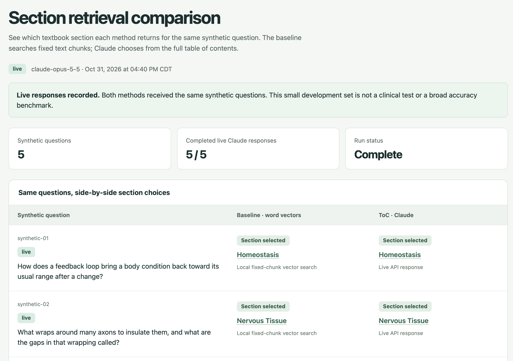
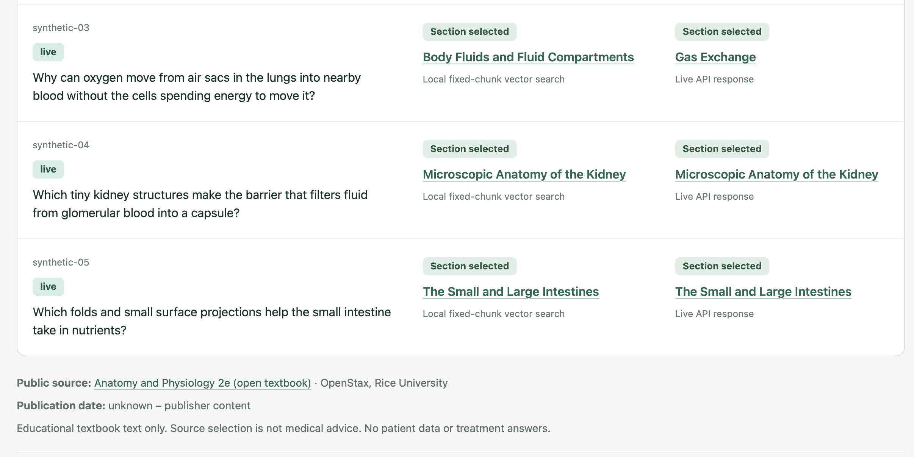
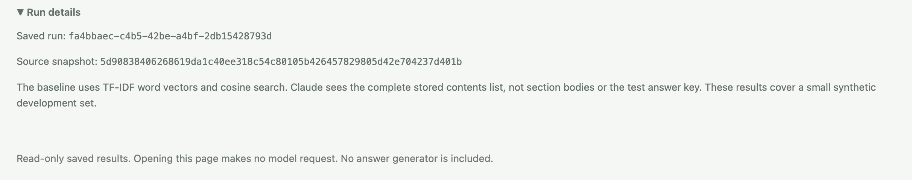

# STAIR Clinical Monitor

A portfolio project comparing the retrieval step of **chunked RAG** with **table-of-contents-aware retrieval** on public OpenStax anatomy and physiology text. Both methods receive the same synthetic questions and return a section title and source link.

- **Chunked baseline:** split the text into fixed, overlapping pieces, then search word-based vectors called TF-IDF. This is a word-matching baseline, not a neural embedding system.
- **ToC-aware retrieval:** show Claude the complete table of contents and ask for an exact section title and ID. Invalid choices stay visible rather than being guessed or repaired.

This is STAIR-inspired, not a claimed reproduction of a published STAIR method. **No answer generator is built.**

[Comparison screenshots](#screenshots-of-the-comparison-page) · [Video recording script](docs/video-script.md)

## Live results

The live development run was recorded on **October 31, 2026**, using **`claude-opus-5-5`**. Source: [saved live run](reports/retrieval-live-results.json) and [dated validation](reports/live-comparison-checks.json). The counts below refer only to that run.

| Method | Sections matching the prepared key | Execution |
| --- | --- | --- |
| Chunked baseline | 4/5 | live |
| ToC-aware retrieval | 5/5 | live |

The ToC choices are recorded Claude responses; baseline choices come from actual vector search. No scripted replies are used in this live run. This small synthetic development set is not a held-out benchmark, evidence of clinical safety, or proof that ToC retrieval beats every other method. Answer faithfulness is not measured because no answers are generated.

[Open the comparison page](reports/comparison.html) · [Inspect the comparison data](reports/comparison-data.json)

Every numerical claim in this README is tied to a dated source. The run records keep the questions, source snapshot, settings, and returned sections.

## Conclusion

In the [live development run recorded on October 31, 2026](reports/live-comparison-checks.json), ToC-aware retrieval matched 5/5 prepared section keys and the fixed-chunk baseline matched 4/5. For the lung question, the baseline selected “Body Fluids and Fluid Compartments” while Claude selected “Gas Exchange,” the prepared target section.

This example illustrates a difference worth testing further. It does not establish a general retrieval advantage. The methods differ in both document structure and their use of Claude versus word-based vectors, so this comparison does not isolate the effect of the table of contents.

The result is a small, reproducible engineering experiment on public textbook text, not a clinical evaluation. It returns section references and uses synthetic questions only. A future evaluation would need a larger, separate question set and a baseline that matches meaning as well as words. Those improvements are not part of the current implementation.

## Screenshots of the comparison page

Below are screenshots of the saved live comparison (opened locally with `open reports/comparison.html`). No API key is required to view these results.

**Overview**  


**Side-by-side results**  


**Run details**  


## Run the comparison

Run commands from the repository root. Use Python and `uv`; [pyproject.toml](pyproject.toml) declares the supported Python versions and [uv.lock](uv.lock) fixes the package versions. The commands below use the recorded run's question count and model. Their options were checked against [the CLI](src/stair_monitor/cli.py) on **October 31, 2026**.

Install dependencies and prepare a fresh checkout:

```sh
uv sync --frozen --cache-dir .cache/uv
.venv/bin/stair init
.venv/bin/stair import-openstax
```

The checkout includes `data/guidelines.sqlite3`, containing the public source and saved results. Raw-download caches remain ignored by Git. The import command above rebuilds that cache and checks the source; it is optional when using the included database. Use `import-openstax --offline` only when the raw source files are already cached. Neither import command calls Claude.

For a live comparison, configure `ANTHROPIC_API_KEY` securely in environment settings and allow `api.anthropic.com`. Never put a key in code, a report, or chat.

```sh
.venv/bin/stair test-retrieval --mode live --limit 5 --model claude-opus-5-5
.venv/bin/stair compare --output reports/reviewer-comparison.html
```

The run is saved in SQLite. The export shows the latest live run, including failures, and requires a new output filename. A fresh Claude run may return different selections; the saved live report is the record of the results above.

To serve the read-only comparison page:

```sh
.venv/bin/stair serve
```

Open the address printed by the server. Viewing saved results makes no model calls. The saved HTML comparison can also be opened without an API key or database.

## Run existing tests

```sh
.venv/bin/python -m pytest -q
```

Tests make no live model calls. Import the source first to include the full-source integration checks; otherwise those checks are explicitly skipped. Scripted ToC replies are test doubles, labelled `offline_scripted`, and must never be presented as live results.

## Data, limits, and attribution

- **Public textbook content and synthetic questions only. No real patient data, ever.**
- The source is an OpenStax educational textbook, not a current treatment guideline. Publication date: **unknown – publisher content**.
- Publisher attribution and reuse terms are recorded in [source verification](docs/source-verification.md). Captions and descriptions are retained; image files and linked videos remain external.
- No real clinical use, hospital deployment, or customer use is claimed. Do not use this project for patient care.
- CDC and WHO access failures remain documented; their content is not part of the comparison.
- Codex was the build partner. This does not mean a clinician reviewed the work.

## Handoff

Read [docs/handoff.md](docs/handoff.md) for finished work, exclusions, and reviewer reproduction steps. Detailed choices are in [assumptions](docs/assumptions.md), [retrieval notes](docs/retrieval.md), and [setup](docs/setup.md).

This handoff adds documentation only. Further stages require the user's **“approved, continue.”**
